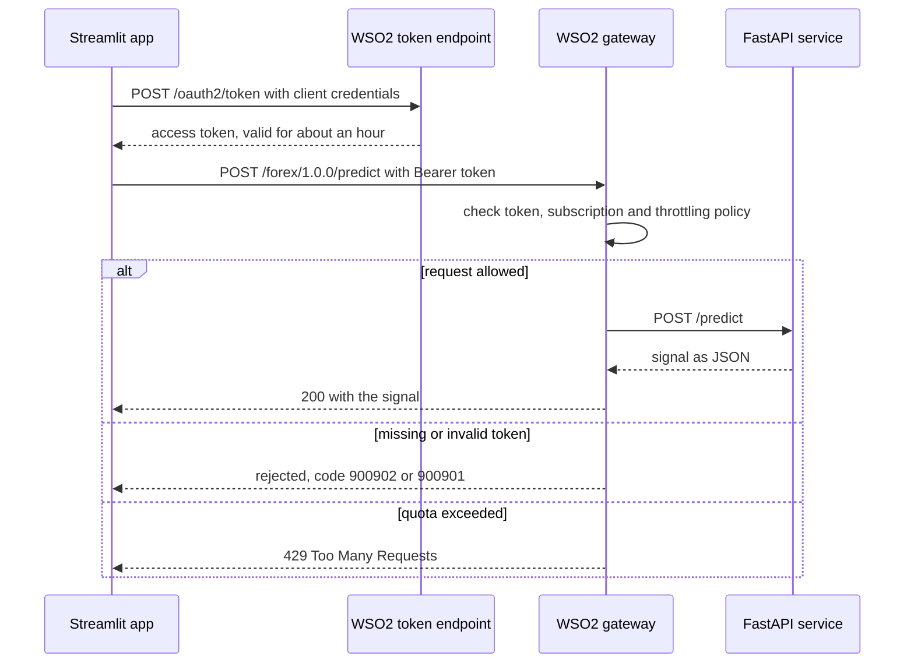

# WSO2 API Manager integration

How the forex signal API was published, secured and rate-limited with WSO2 API Manager, what was observed at the gateway, and what was not done. Back to the [README](../README.md).

## Environment

| Part | Value |
|---|---|
| WSO2 API Manager | 4.7.0, running locally on Windows with JDK 21 |
| Backend | FastAPI service on `http://localhost:8000` |
| Gateway (HTTPS) | port 8243, API base `https://localhost:8243/forex/1.0.0` |
| Token endpoint, Publisher, Developer Portal, Admin Portal | port 9443 |
| API contract | `openapi.json` (OpenAPI 3.0.2, generated by FastAPI) |

The local installation uses a self-signed certificate, so `curl.exe` calls use `-k`. That is acceptable on a laptop only.

## What the gateway does for this API



## What was configured

| WSO2 capability | What I configured | What I observed |
|---|---|---|
| Publisher: API from an OpenAPI definition | Imported the FastAPI definition as `ForexDirectionAPI`, context `/forex`, version `1.0.0`, endpoint `http://localhost:8000` | Linter: 0 errors, 16 warnings (documentation suggestions only). Lifecycle history: CREATED to PUBLISHED |
| OAuth2 security | Left the default OAuth2 security on; created the application `forex-app`, subscribed it, generated keys | Calls without a token were rejected before reaching the backend |
| Application and subscription | A token only works for the application that holds the subscription | After changing plans, calls returned 403 until I used a token from the subscribed application |
| Subscription throttling | Admin Portal policy `Demo5PerMin`, 5 requests per minute, attached to the API with the Unlimited plan removed | 429 responses once the quota was exceeded (see below) |
| Application-level throttling | The application used the built-in `50PerMin` plan | A second, separate limit across all of the application's APIs |
| Revisions | Re-imported the definition and deployed a new revision when the API changed | Existing application, subscription and plan carried over |

## How to reproduce it

1. **Run the backend.** From the project root: `uvicorn src.api.main:app --port 8000`.
2. **Create the API.** Publisher at `https://localhost:9443/publisher`: Create API, REST API, Import OpenAPI, choose the URL `http://localhost:8000/openapi.json`. Set name `ForexDirectionAPI`, context `/forex`, version `1.0.0`, endpoint `http://localhost:8000`, then Create.
3. **Check it.** API Configurations, Resources: `/health`, `/currencies`, `/model-info` and `/predict` should be listed. Runtime: OAuth2 stays enabled.
4. **Set the throttling plan.** Admin Portal (`https://localhost:9443/admin`): Rate Limiting Policies, Subscription Policies, add a policy (for example `Demo5PerMin`, 5 requests per 1 minute). Back in the Publisher, Portal Configurations, Subscriptions: tick that plan and untick Unlimited, then save.
5. **Deploy and publish.** Deployments: deploy a revision and wait for the green state, then Lifecycle: Publish.
6. **Create the consumer.** Developer Portal (`https://localhost:9443/devportal`): Applications, add `forex-app`, open the API, Subscriptions, subscribe the application with the plan. Open the application's Production Keys, generate keys, and note the consumer key and secret.
7. **Get a token and call the API.** In PowerShell (use `curl.exe`, because plain `curl` is an alias for something else):

```powershell
$resp = curl.exe -k -s -u "<consumer-key>:<consumer-secret>" -d "grant_type=client_credentials" https://localhost:9443/oauth2/token | ConvertFrom-Json
$TOKEN = $resp.access_token
'{"currency":"LKR"}' | Out-File -Encoding ascii body.json
curl.exe -k -X POST https://localhost:8243/forex/1.0.0/predict -H "Authorization: Bearer $TOKEN" -H "Content-Type: application/json" -d "@body.json"
```

The Streamlit app does the same thing in code (`app/gateway_client.py`): it gets a token, keeps it until shortly before it expires, retries once with a fresh token on a 401, and turns a 429 into a plain message. The key and secret come from a git-ignored `.env` file.

## Observed gateway behaviour

Copied from the terminal.

```text
# No token
{"code":"900902","message":"Missing Credentials","description":"Invalid Credentials. Make sure your API invocation call has a header: 'Authorization : Bearer ACCESS_TOKEN' or 'Authorization : Basic ACCESS_TOKEN' or 'ApiKey : API_KEY'"}

# A value that was not a valid access token
{"code":"900901","message":"Invalid Credentials","description":"Access failure for API: /forex/1.0.0, version: 1.0.0 status: (900901) - Invalid Credentials. Make sure you have provided the correct security credentials"}

# A resource added in code but not yet imported and deployed in WSO2
{"code":"404","type":"Status report","message":"Runtime Error","description":"No matching resource found for given API Request"}

# With a valid token: GET /health and GET /currencies through the gateway
{"status":"ok"}{"currencies":["USD","GBP","JPY","CHF","AUD","CAD","LKR"]}

# 15 calls, 0.7 seconds apart, on the 5-per-minute plan
call 1 to call 10 -> HTTP 200
call 11 to call 15 -> HTTP 429
```

### Why ten calls got through a limit of five

WSO2's documentation on rate limit enforcement describes two effects. Enforcement is **asynchronous**: the gateway lets a request through and reports it to a separate traffic manager, which tells the gateway when a limit has been exceeded, so a burst can slip past the nominal limit. Counts are also kept in **fixed clock windows**, so a 60-second span can straddle two windows. My test cannot say which effect produced ten, so I do not claim one. A rate limit is a protective guardrail, not an exact counter. A throttled request returns HTTP 429 with code 900800, according to the documentation.

## Things that went wrong, and what they taught me

| Symptom | Cause | Fix |
|---|---|---|
| WSO2 would not accept the generated spec cleanly | FastAPI emits OpenAPI 3.1 by default; WSO2 4.x expects 3.0.x | Set `app.openapi_version = "3.0.2"` and avoid nullable fields |
| 404 on a new endpoint through the gateway, while the backend answered | The gateway only knows what has been imported and deployed | Re-import the definition, deploy a new revision |
| 900901 Invalid Credentials | A value that was not an access token (most likely the short consumer key, copied from the same page) | Request a token from the token endpoint and copy only `access_token` |
| 403 on every call after changing plans | The token belonged to an application other than the one holding the subscription | Generate the token under the subscribed application |
| Ten calls allowed on a 5-per-minute plan | Asynchronous enforcement and clock windows (see above) | Treat limits as guardrails |

## Not done

- **OAuth scopes** on individual operations: any subscribed application can call every operation, so authentication is thorough but authorization is coarse.
- **WSO2 analytics and monitoring.**
- **API versioning in practice.** A breaking change (the `signal` field was removed) was rolled out under the same version, which is acceptable with a single consumer. With real consumers it should be a new major version, with the old one deprecated.
- **Production deployment**: proper certificates, a containerised or clustered WSO2, and secret management beyond a git-ignored `.env`.
- **An exported API project** (Publisher, Download API) committed to the repository, so the API can be imported into another WSO2 instance in one step.
