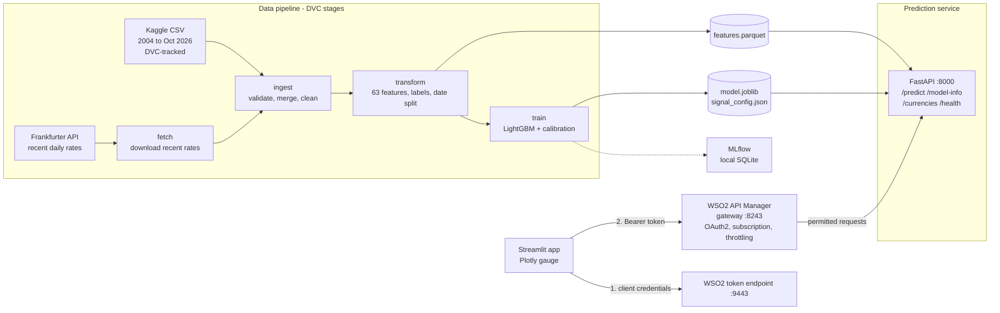
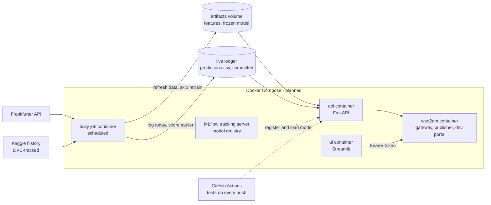

# Forex Direction Signal API

A reproducible machine-learning pipeline that estimates the probability that a currency's exchange rate against the euro will be higher on the **next trading day**, served through **WSO2 API Manager** (OAuth2, subscriptions, rate limiting) and consumed by a Streamlit app.

> **Educational project, not financial advice.** Daily currency direction is close to unpredictable, and this project measures that honestly instead of hiding it (see [Results](#results-and-what-they-mean)). The point of the project is the engineering around the model: a tested data pipeline, an API contract, and a managed gateway.

Related article: *Beyond the Endpoint: How WSO2 API Manager Helps Build Secure and Reliable APIs* ([link](https://medium.com/@malithiaradhya53/beyond-the-endpoint-what-i-learned-putting-a-forex-signal-api-behind-wso2-api-manager-6a69b3d909a3)).

## WSO2 API Manager at a glance

The prediction service never faces its callers directly; every call goes through a WSO2 API Manager 4.7 gateway.

- **Published from a contract.** FastAPI's OpenAPI 3.0.2 definition was imported as `ForexDirectionAPI` (context `/forex`, version `1.0.0`) and published through the Publisher.
- **OAuth2 at the gateway.** An application is subscribed to the API and obtains short-lived tokens with the client-credentials grant. Requests without a valid token are rejected before they reach the backend.
- **Rate limiting.** A subscription policy of 5 requests per minute was attached, and over-quota requests were rejected with HTTP 429.
- **Managed change.** API changes were rolled out as new revisions without recreating the application or its subscription.
- **A real consumer.** The Streamlit app talks only to the gateway, caches its token, refreshes it on a 401, and shows a plain message on a 429.

Full walkthrough, the exact steps, observed gateway responses and the problems I hit: **[docs/wso2-integration.md](docs/wso2-integration.md)**.

## What is built, and what is not

| Area | Status |
|---|---|
| EDA and model experiments (`notebooks/`) | Done |
| Data ingestion: schema checks, cleaning, glitch repair (`src/components/data_ingestion.py`) | Done |
| Recent-data fetch from the Frankfurter API, with an overlap check and splice at the seam (`data_fetch.py`) | Done |
| Feature engineering: 63 numeric features, no look-ahead (tested) (`data_transformation.py`) | Done |
| LightGBM training, probability calibration, signal tiers, MLflow run tracking (`model_trainer.py`) | Done |
| DVC pipeline: `fetch`, `ingest`, `transform`, `train`, with parameters in `params.yaml` | Done |
| FastAPI prediction service with an OpenAPI 3.0.2 contract (`src/api/main.py`) | Done |
| **WSO2 API Manager integration**: OpenAPI import, publish, OAuth2 client credentials, application subscription, subscription throttling | Done |
| Streamlit client that calls the API only through the WSO2 gateway (`app/`) | Done |
| Automated tests (32): pipeline, no-look-ahead, merge logic, API, gateway client, UI | Done |
| Docker and Docker Compose for the whole stack | Planned |
| Frozen training window, scheduled daily job, and a live prediction ledger scored against real outcomes | Planned |
| GitHub Actions CI | Planned |
| MLflow model registry (runs are tracked today; registration is not) | Planned |
| OAuth scopes per operation, WSO2 analytics | Planned |

## Architecture

### What exists today



How a request flows:

1. The Streamlit app exchanges its consumer key and secret for a short-lived access token at the WSO2 token endpoint (OAuth2 client-credentials grant).
2. It calls the gateway on port 8243 with `Authorization: Bearer <token>`.
3. The gateway checks the token and the application's subscription, applies the throttling policy, and only then forwards the request to the FastAPI service on port 8000.
4. FastAPI builds the model input from the latest row of `features.parquet`, runs the calibrated model, and returns the signal.

### Where it is heading (planned, not built)



The main design decision for the planned version is to separate **refreshing data** from **retraining**: the model is trained once on a frozen window and versioned, a scheduled job refreshes the latest data every day without retraining, and every prediction is written to an append-only ledger and scored against the rate that actually followed. That gives a true forward track record, which is the only honest way to evaluate a model like this.

## How it works

| Stage | Command | Reads | Writes |
|---|---|---|---|
| fetch | `python -m src.components.data_fetch` | Kaggle CSV (for its last date), Frankfurter API | `data/raw/recent_rates.csv` |
| ingest | `python -m src.components.data_ingestion` | Kaggle CSV, recent rates | `artifacts/clean.parquet` |
| transform | `python -m src.components.data_transformation` | `clean.parquet` | `features.parquet`, `fit.parquet`, `calibration.parquet`, `test.parquet` |
| train | `python -m src.components.model_trainer` | the three split files | `model.joblib`, `signal_config.json`, `metrics.json` |

`dvc repro` runs the stages in order and skips any whose inputs and parameters have not changed. All tunable values live in `params.yaml`.

**Prediction target.** For each currency and trading day *t*, the label is whether the next trading day's EUR-to-currency rate is higher. Every feature at row *t* uses information through day *t* only; a test (`test_features_have_no_lookahead`) proves that changing later data cannot change earlier features.

**Data.** The Kaggle dataset `asaniczka/forex-exchange-rate-since-2004-updated-daily` (2004 to October 2026, 176 currencies, EUR base) is used for 7 currencies: USD, GBP, JPY, CHF, AUD, CAD and LKR. Weekends are dropped so a lag always means "previous trading day". A rule flags a move above 10% that reverses the next day as a data glitch; none of these 7 currencies trigger it.

**Recent days.** The Kaggle file ends a few days behind. Recent rates come from the Frankfurter API. The two sources are close but not identical (for USD, the median difference on overlapping days was 0.08% and the maximum 0.35%, against a typical daily move of about 0.39%), so the merge checks the overlap, refuses to continue if the sources disagree by more than 0.5% at the median, and rescales the new rates at the last common day so no artificial jump appears at the seam.

**Model.** Lags and rolling statistics of daily returns, EWMA volatility, price deviation from moving averages, calendar features and cross-currency market features feed a LightGBM classifier. The time-ordered split is: fit, then a calibration slice (Platt scaling), then a test window of about 8,000 days from May 2022. "Strength" is how far the calibrated probability is from 50/50, in tiers fixed from the calibration slice.

## Results and what they mean

Out-of-sample test window, 7 currencies, about 7,970 currency-days:

| Measure | Value |
|---|---|
| Accuracy | about 51% (50.8% to 51.0%, depending on whether recent API rows are included), against 49.6% for always guessing the training majority class |
| ROC-AUC | about 0.52 (0.5 means no skill) |
| Log loss, calibrated | 0.693, against 0.6932 for predicting the base rate only |
| Hit rate by strength tier (Kaggle-only run) | high 52.1% (867 days), medium 51.1% (1,723), low 50.5% (5,374) |

**Reading these honestly.** The model is statistically close to a coin flip. The tier hit rates rise in the expected order, but the high tier's 52.1% on 867 days sits inside the normal luck range of roughly plus or minus 3 points around 50%, so it is a hint, not evidence. The seven pairs are all quoted against the euro and move together, so the effective sample is smaller than it looks. Several other models, a volatility target and technical indicators were tried in notebooks; none changed this picture. "High" strength means the model's most confident calls, not a likely win.

## WSO2 API Manager integration

Configured and verified on a local WSO2 API Manager 4.7.0: OpenAPI import and publication, OAuth2 client-credentials security, an application subscription, a 5-requests-per-minute subscription policy, and revision-based changes. The gateway returned `900902` for a missing token, `900901` for an invalid one, `404` for a resource that was not yet deployed, and `429` once the quota was exceeded.

Ten calls got through a limit of five. WSO2's documentation explains why: enforcement is asynchronous and counted in fixed clock windows, so the limit is a guardrail, not an exact counter.

The setup steps, the observed responses and the problems I ran into are in **[docs/wso2-integration.md](docs/wso2-integration.md)**. Not done: OAuth scopes per operation, WSO2 analytics, and production-grade TLS.

## API

| Method and path | Purpose |
|---|---|
| `GET /health` | Liveness check |
| `GET /currencies` | Supported currency codes |
| `GET /model-info` | Model version, data date, out-of-sample accuracy and AUC |
| `POST /predict` | Signal for one currency: `{"currency": "LKR"}` |

Example `POST /predict` response (values are illustrative):

```json
{
  "currency": "LKR",
  "as_of_date": "2026-10-09",
  "for_trading_day": "2026-10-12",
  "horizon": "next trading day",
  "prob_up": 0.4731,
  "direction": "down",
  "strength": "medium",
  "historical_hit_rate": 0.5113,
  "historical_sample_size": 1723,
  "model_version": "lgbm-1",
  "disclaimer": "Educational project. Not financial advice. ..."
}
```

`as_of_date` is the last trading day in the data. On a Friday, `for_trading_day` is the following Monday.

## Quickstart

Tested on Python 3.12. The gateway part also needs WSO2 API Manager 4.x and JDK 21.

```powershell
git clone https://github.com/aradhya534/forex-engine
cd forex-engine
py -3.12 -m venv .venv
.\.venv\Scripts\Activate.ps1
python -m pip install --upgrade pip
pip install -r requirements.txt
```

**Data.** The raw dataset is tracked with DVC but no remote is configured, so download it from [Kaggle](https://www.kaggle.com/datasets/asaniczka/forex-exchange-rate-since-2004-updated-daily) and save it as `data/raw/daily_forex_rates.csv`. Check you have the same file the pipeline was built on:

```powershell
Get-FileHash data\raw\daily_forex_rates.csv -Algorithm MD5   # expect 115C4D6F40125C05DAAD08A8F5929FCC
```

**Run the pipeline and the tests.**

```powershell
dvc repro                       # needs internet for the fetch stage
python -m pytest tests -q       # 32 tests
```

To run offline, set `fetch.enabled: false` in `params.yaml`; the pipeline then uses the Kaggle file only.

**Serve the API.**

```powershell
uvicorn src.api.main:app --port 8000
```

**Put it behind WSO2** (Publisher at `https://localhost:9443/publisher`): create an API by importing `http://localhost:8000/openapi.json`, set the context to `/forex` and the endpoint to `http://localhost:8000`, deploy a revision and publish. In the Developer Portal, create an application, subscribe it to the API and generate keys. In the Admin Portal, optionally add a subscription policy such as 5 requests per minute.

**Run the Streamlit client.** Copy `.env.example` to `.env`, fill in the application's consumer key and secret, then:

```powershell
streamlit run app/main.py
```

`.env` is git-ignored. Never commit the consumer secret; if it leaks, regenerate the keys in the Developer Portal.

## Repository layout

```text
forex-engine/
├── app/                  Streamlit client and the WSO2 gateway client
├── artifacts/            pipeline outputs (managed by DVC)
├── data/raw/             dataset pointer (.dvc); the CSV itself is downloaded
├── docs/                 WSO2 API Manager walkthrough and evidence
├── notebooks/            EDA and model experiments
├── src/
│   ├── api/              FastAPI service
│   ├── components/       fetch, ingestion, transformation, training, shared helpers
│   ├── pipeline/         prediction pipeline
│   ├── exception.py
│   └── logger.py
├── tests/                32 automated tests
├── dvc.yaml              pipeline definition
├── params.yaml           all tunable parameters
├── openapi.json          the API contract imported into WSO2
└── requirements.txt
```

## Limitations

- The model has almost no predictive skill; treat the API as a demonstration of API management, not a trading tool.
- The seven pairs are correlated, so their daily outcomes are not independent evidence.
- The recent rates come from a different source than the historical file; the merge checks and splices them, but a small source mismatch remains.
- The dataset has no remote storage configured, so it must be downloaded manually.
- The stack runs locally; there is no container setup or CI yet.

## Disclaimer

For education only. Nothing here is financial advice, and the signal should not be used to trade.
